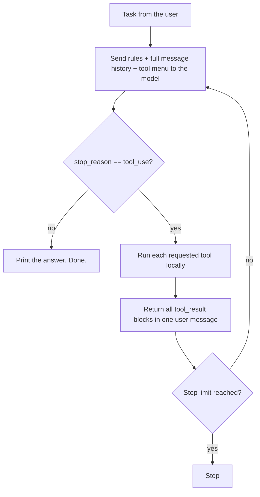
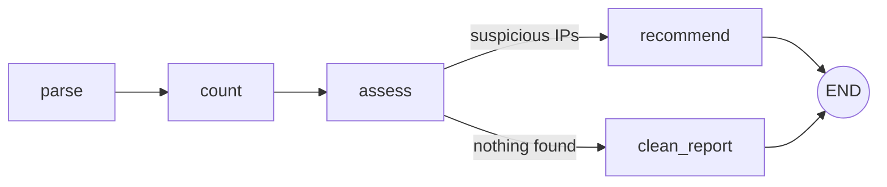

# Agent Harness from Scratch

[](../../actions/workflows/ci.yml)


A minimal LLM agent harness in plain Python, built step by step to understand
how AI agents actually work: no agent framework, just the
[Anthropic Messages API](https://platform.claude.com/docs/en/api/messages)
and about 150 lines of code.

A language model on its own only turns text into text. It cannot run a command,
write a file or remember the previous step. Everything that makes it act is the
code around it: tools, a loop, memory, rules and limits. That code is the
**harness**, and this repository builds one from the ground up.

> This is a learning project. It is meant to be read, run and modified,
> not deployed to production.

## What this repository demonstrates

- **Tool use (function calling):** tool definitions as JSON Schema, the
  `tool_use` / `tool_result` exchange and how `stop_reason` drives the loop.
- **The ReAct agent loop:** reason, act, observe, repeat, with a hard step limit.
- **Sandboxing:** file writes are confined to a `workspace/` directory.
- **Hooks and context compaction:** automatic tests after every edit, and
  summarising old turns with a cheaper model when the history grows.
- **Loop vs. graph orchestration:** the same idea expressed as a loop, as a
  one-node graph and as a branching graph (runs without an API key).
- **Testing agents without an API:** the loop is tested end to end with a
  fake model client, and CI runs the tests on every push.

## Concepts

| Concept | What it means | Where to look |
|---|---|---|
| **Harness** | Everything around the model: tools, memory, rules, limits | `harness.py` |
| **Loop** | Repeat one step until the work is done: ask, act, return the result | `run_agent()` in `harness.py` |
| **Graph** | Several steps (nodes) with explicit transitions (edges) and branching | `loop_vs_graph.py` |

In one line: the harness surrounds the model, the loop repeats, the graph
decides the path. A loop is the simplest graph: one node that points back to itself.

## How the agent loop works



Two things surprised me most while building this:

1. **The model never executes anything.** It only *asks* for a tool by name.
   The harness runs the function on the local machine and sends the output back.
2. **The API is stateless.** The whole message list is sent again on every turn.
   In one real run (adding a function and its tests), the agent needed 7 steps
   and the input grew from 666 to 2,221 tokens per request. That is why a step
   limit is both a safety brake and a cost brake.

## Files

| File | Purpose | API key needed? |
|---|---|---|
| `loop_vs_graph.py` | Loop vs. graph, shown on a small security log review. **Start here.** | No |
| `harness.py` | The smallest useful agent: two tools (`run_command`, `write_file`) and the loop. | Yes |
| `harness_debug.py` | The same loop, printing the `messages` list and the raw model response every turn. | Yes |
| `harness_full.py` | Adds shell detection, a post-edit pytest hook, context compaction and output limits. | Yes |
| `AGENTS.md` | Rules the agent reads on every run. Each mistake the agent makes becomes a new rule here. | No |
| `tests/` | Tests for the sandbox, tool errors and the loop itself (fake client, no API calls). | No |

## Quick start

Requires Python 3.12 or newer.

```bash
python -m venv .venv
source .venv/bin/activate          # Windows (Git Bash): source .venv/Scripts/activate
python -m pip install -r requirements-dev.txt

# 1) No API key needed
python loop_vs_graph.py

# 2) With an API key from https://platform.claude.com
export ANTHROPIC_API_KEY="your-key"  # Windows: setx ANTHROPIC_API_KEY "your-key", then open a new terminal
python harness.py                    # asks for a task, e.g. "write add(a, b) and a test for it"
python harness_debug.py              # same, but shows what happens inside
python harness_full.py "write add(a, b) and a test for it"
```

The agent only writes inside `workspace/`, which is created next to the scripts.

> **Windows note:** use a regular Python build. The free-threaded build
> (`python3.13t`) cannot install some dependencies from prebuilt wheels.

## Example: loop vs. graph

`python loop_vs_graph.py` reviews a small login log. The graph section takes a
different path depending on what it finds:

```text
=== 3) GRAPH (suspicious log) ===
  step 1: [parse]
  step 2: [count]
  step 3: [assess]
  step 4: [recommend]
  Report:
  - 203.0.113.5 [HIGH]: successful login after repeated failures. Reset the password ...
  - 198.51.100.9 [MEDIUM]: repeated failed logins, no successful login. Keep monitoring ...

=== 3) GRAPH (clean log) ===
  step 1: [parse]
  step 2: [count]
  step 3: [assess]
  step 4: [clean_report]
```



Only `assess` needs judgement. In a real agent it would be the only node that
calls the model; `parse` and `count` stay plain code. That is the practical
benefit of a graph: you pay for model reasoning only where reasoning is needed.

## Tests

```bash
python -m pytest     # 16 tests, no API key, no network
ruff check .         # lint
```

The loop is tested with a `FakeClient` that returns scripted responses. The
tests check, among other things, that:

- `write_file` refuses paths that escape the workspace (`../`, absolute paths),
- unknown tools and bad arguments come back as error text instead of crashing,
- parallel tool calls are answered in **one** user message, matched by `tool_use_id`,
- the loop stops at `MAX_STEPS`.

## Design decisions

- **No framework.** Every mechanism is visible in a few lines of code.
- **Errors are tool results.** Unknown tools, wrong arguments and timeouts are
  returned to the model as text, so it can recover instead of the program crashing.
- **Paths relative to the script.** `AGENTS.md` and `workspace/` are found via
  `Path(__file__)`, so the scripts work no matter which directory they start in.
- **Same Python for the agent.** Commands run with the harness's own
  interpreter first on `PATH`, so `python` and `pytest` use the same virtual environment.
- **Compaction keeps pairs intact.** When old turns are summarised, the kept part
  always starts with an assistant message, so a `tool_use` is never separated
  from its `tool_result`.
- **Hooks: success is silent, failure is loud.** The pytest hook only adds
  output to the tool result when tests fail.

## Lessons learned: the "ratchet"

Every mistake the agent makes should turn into a rule or a fix, so it cannot
happen again. Two examples from building this repository:

- In an early run the agent installed a package on its own. Result: a new rule in
  `AGENTS.md`: *"Never install packages. If a package is missing, stop and tell the user."*
- In another run the agent could not find `python`, tried `python3`, then `py`,
  and finally ran the tests with the system Python instead of the project's
  virtual environment. The tests passed, but in the wrong environment. Result:
  the harness now puts its own interpreter first on `PATH` for every command.

## Security notes

- `write_file` is sandboxed to `workspace/`. **`run_command` is not a real sandbox:**
  commands run on your machine with your permissions. Try new tasks in a
  throwaway folder, a VM or a container.
- The API key is read from the environment only. `.env` files are git-ignored.
- `MAX_STEPS` bounds both runaway behaviour and cost.

## Next steps

- Replace the `assess` node in `loop_vs_graph.py` with a real model call.
- Add a reviewer node that checks the report and sends it back on failure.
- Move the tools into an MCP server and connect the harness to it.
- Detect brute force within a time window (e.g. 3 failures in 5 minutes).

## Acknowledgements

The structure follows the ideas in DataCamp's
[Agent Harness Engineering](https://www.datacamp.com/tutorial/agent-harness-engineering)
tutorial. The code here is my own implementation, written while learning, with
Claude as a pair-programming assistant.

## License

[MIT](LICENSE)
